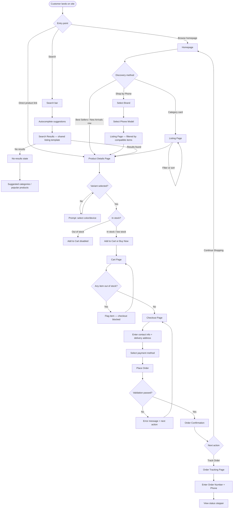

# Joy Telecom E-Commerce — V1 (P0) Product Blueprint

Scope: everything needed to start building the P0 launch version — confirmed requirements, page list, components, and user flows. Read top to bottom.

---

## 1. Priority Conflicts Found in the SRS (resolve these first)

The BRD's own **V1/V2 Boundary table (Section 8)** disagrees with the **per-requirement priority tags (Section 4)** in seven places. Building against both as-is will cause scope creep. Here's each conflict and the recommended call:

| # | Item | Tagged in Section 4 | Says in Section 8 Boundary Table | Recommendation |
|---|------|---------------------|-----------------------------------|-----------------|
| 1 | Login / Register / Account Dashboard / Order History / Profile (WEB-ACC-001–004) | P0 | V2 ("full account dashboard") | **Defer to V2.** Ship guest checkout for V1. Order Tracking (WEB-TRK, no login required) already gives customers post-purchase visibility without an account system. |
| 2 | Wishlist (WEB-WISH-001–002) | P0 | V2 | **Defer to V2.** WEB-WISH-002 itself requires login to persist — since login is deferred, this falls away automatically. |
| 3 | Account Settings (WEB-SET-001–003) | P0 | V2 ("Settings") | **Defer to V2** — depends on Account existing first. |
| 4 | Wishlist/Account icons in global header (WEB-GLB-001) | P0 | — (not addressed) | Keep the icon slots in the header for forward-compatibility, but for V1 either hide them or route to a simple "Coming soon" state. Not a blocker — a UI decision. |
| 5 | Dedicated Support/Help Center page (WEB-HELP-001–002) | P0 | V2 ("Support/Help center") | **Defer the standalone Help Center page to V2.** Keep the floating Support widget (WEB-SUP, a separate module) — it's cheap and BRD-TRUST-01 needs visible contact options before purchase. The Contact page (WEB-INFO-002, correctly P0) covers the gap for launch. |
| 6 | Reviews display (WEB-PDP-012 tagged P1; WEB-HOME-009 tagged P1) | P1 | Boundary table lists "Reviews display" as V1 P0 | **Elevate a basic version to P0:** star rating, review count, written text, reviewer name on the PDP. Leave review images, verified-purchase badges, and the homepage testimonials row as P1 polish — this matches the V2 table's separate line for "Reviews with images." |
| 7 | Privacy Policy, Terms & Conditions, FAQ, 404 page | Not defined anywhere in Section 4 | Boundary table lists these as V1 P0 | **Real gap — add as lightweight P0 pages.** No functional requirements exist for them in the SRS. Flagging this matters because bKash/Nagad merchant approval typically requires a published Privacy Policy and Terms, so this can't slip to V2 without blocking payments. |

Everything below reflects these resolutions as the **confirmed P0 scope**.

---

## 2. Confirmed P0 Requirements Checklist

### Global (WEB-GLB)
- [ ] Header: logo, search bar ("Search products, brands or phone models..."), category nav, Cart icon (Account/Wishlist icons per conflict #4)
- [ ] Announcement bar: admin-editable text, on/off toggle
- [ ] Mobile hamburger menu: full category + device nav
- [ ] Footer: Shop, Categories, Customer Service, Company links, social icons

### Homepage (WEB-HOME)
- [ ] Hero: value prop, "Shop Now" CTA, "Explore Categories" secondary CTA
- [ ] Featured Category cards (image, name, label, click-through)
- [ ] Shop by Phone module (primary homepage feature)
- [ ] Best Sellers row (product cards)
- [ ] New Arrivals row
- [ ] "Why Joy Telecom?" trust section (5 icon points)

### Shop by Phone ★ (WEB-DEVICE)
- [ ] Brand → Phone Model → Compatible Accessories flow
- [ ] Results show only fitting items (Cases, Glass, Camera Protectors, Chargers, Cables, MagSafe)
- [ ] Placed as a primary homepage element, not a buried filter
- [ ] Compatibility confirmed at every step (BR-DEVICE-01)

### Product Listing / Category (WEB-PLP)
- [ ] Breadcrumb
- [ ] Page title + product count
- [ ] Sorting: Popular, Newest, Price ↑↓, Highest Rated, Biggest Discount
- [ ] Filters: Brand, Price, Device, Model, Category, Compatibility, Availability, Rating, Discount
- [ ] Responsive product grid

### Product Card (WEB-CARD)
- [ ] Image, brand, name, rating + review count, price + strike-price + discount %, Add to Cart
- [ ] Stock states: in stock / low stock ("Only 3 left") / out of stock (CTA disabled)

### Product Details Page ★ (WEB-PDP)
- [ ] Gallery: multiple images, zoom, thumbnails, video
- [ ] Info: brand, name, rating, review count, SKU, price, discount, stock
- [ ] Variant selection: Color, Device/Model — mandatory before add-to-cart
- [ ] Key features with icons
- [ ] Compatibility section ★ (compatible devices, prominent)
- [ ] Tabs/accordions: description, specs, materials, dimensions, what's included
- [ ] Warranty info
- [ ] Delivery info (Dhaka vs. outside Dhaka estimates)
- [ ] Add to Cart / Buy Now — sticky on mobile
- [ ] Related Products ("You May Also Like")
- [ ] Basic reviews display: rating, count, text, reviewer name *(elevated — see conflict #6)*

### Search (WEB-SRCH)
- [ ] Search across product names, brands, categories, phone models, keywords
- [ ] Autocomplete suggestions
- [ ] Results page reuses PLP's sort/filter

### Cart (WEB-CART)
- [ ] Line items: image, name, variant, qty, price, discount, remove
- [ ] Summary: Subtotal, Discount, Delivery, Total
- [ ] "Proceed to Checkout" CTA
- [ ] Out-of-stock items flagged and blocked from checkout (BR-CART-01)

### Checkout (WEB-CHK)
- [ ] Customer info: Name, Phone, Email (optional) — no login required
- [ ] Delivery address: Division, District, Area, Full Address
- [ ] Payment options shown: COD (active), bKash/Nagad/Card (UI only, gateway activation is V2)
- [ ] Order summary: products, qty, subtotal, delivery, discount, total
- [ ] "Place Order" CTA

### Order Confirmation (WEB-CONF)
- [ ] "Order Confirmed!" screen: order #, summary, total, address, payment method, ETA
- [ ] CTAs: Track Order (primary), Continue Shopping

### Order Tracking (WEB-TRK)
- [ ] Lookup by Order Number + Phone Number — no login required
- [ ] Status stepper: Placed → Confirmed → Processing → Shipped → Out for Delivery → Delivered

### Contact (WEB-INFO-002)
- [ ] Store address, phone, WhatsApp, Facebook/Messenger, hours, Google Map, contact form, "Get Directions" CTA

### Customer Support widget (WEB-SUP)
- [ ] Floating widget on all pages: Messenger, WhatsApp, phone call
- [ ] Must never obstruct mobile purchase actions / sticky CTAs (BR-SUP-01)

### UX Feedback States (WEB-UX)
- [ ] Notifications: success, error, low stock, out of stock, discount badge, order placed
- [ ] Empty states: empty cart, no search results (+ suggested categories)
- [ ] Loading states: skeletons for grids, search, checkout, tracking
- [ ] Error states: network, payment failed, product unavailable, checkout error, invalid address, server error
- [ ] Every error state includes a next action (BR-ERR-01)

### Language readiness (WEB-LANG)
- [ ] Layout tolerates longer Bangla text without breaking (design-only for V1, no toggle yet)

### Policies & housekeeping (gap-fill, see conflict #7)
- [ ] Privacy Policy page
- [ ] Terms & Conditions page
- [ ] FAQ page (or section)
- [ ] 404 page

---

## 3. Page List (V1 Sitemap)

**Engineering note:** Shop-by-Phone results, Category browsing, and Search results all use the *same* PLP template with a different data source — WEB-SRCH-003 confirms search results reuse listing sort/filter. Build one listing template, not three.

| # | Page | Notes |
|---|------|-------|
| 1 | Homepage | `/` |
| 2 | Shop by Phone — Brand select | Modal or step, not necessarily a full route |
| 3 | Shop by Phone — Model select | Second step of same flow |
| 4 | Listing / PLP | Shared template — used for category browse, device-filtered results, and search results |
| 5 | Product Details Page | `/product/[slug]` |
| 6 | Cart | `/cart` |
| 7 | Checkout | `/checkout` |
| 8 | Order Confirmation | `/order-confirmed/[order-id]` |
| 9 | Order Tracking | Lookup form + status view, one page with two states |
| 10 | Contact | `/contact` |
| 11 | Privacy Policy | `/privacy` |
| 12 | Terms & Conditions | `/terms` |
| 13 | FAQ | `/faq` |
| 14 | 404 | Catch-all |

**Deferred to V2** (per Section 1): Login/Register, Account Dashboard, Order History, Profile, Address Book, Wishlist, Account Settings, About page, dedicated Help Center page, Deals, Promo pages, Events, Product Compare, Store Locator, Request Product, Coupon.

---

## 4. Components & UI Elements Needed

**Global / Layout**
- Header (logo, search bar, category nav, cart icon w/ count)
- Announcement bar (editable, toggleable)
- Mobile hamburger nav (category + device tree)
- Footer (4 link groups + social icons)
- Breadcrumb
- Floating support widget (Messenger / WhatsApp / Call)

**Homepage**
- Hero banner (headline, subtext, primary + secondary CTA)
- Featured category card
- Shop-by-Phone module (brand grid → model grid)
- Product row/carousel (Best Sellers, New Arrivals)
- Trust section (5-icon grid)

**Discovery**
- Search bar with autocomplete dropdown
- Filter panel (9 facets: brand, price, device, model, category, compatibility, availability, rating, discount)
- Sort dropdown
- Responsive product grid
- Product card (image, brand, name, rating+count, price/strike-price/discount%, stock badge, Add to Cart)
- No-results / empty state

**Product Detail**
- Image gallery with zoom, thumbnails, video support
- Variant selector (color swatches, device/model dropdown or pills)
- Icon-based feature list
- Compatibility badge/block
- Tabbed or accordion info panel
- Warranty info block
- Delivery estimate block
- Sticky mobile purchase bar
- Related products row
- Review summary + review list

**Cart & Checkout**
- Cart line item (image, name, variant, qty stepper, price, remove, OOS flag)
- Cart summary box (subtotal, discount, delivery, total)
- Checkout form (contact info + address fields: Division/District/Area/Address)
- Payment method selector (COD / bKash / Nagad / Card)
- Order summary sidebar
- Place Order CTA

**Post-Purchase**
- Order confirmation card
- Order tracking lookup form
- Order status stepper (6 stages)

**System / Feedback**
- Toast notification (success / error)
- Skeleton loaders
- Error state block (message + next-action button)
- Empty state block
- Stock badge (in stock / low stock / out of stock)
- Discount badge

---

## 5. User Flow (Top to Bottom)

**Edge cases baked into this flow (per BR-ERR-01, every dead end needs a next action):**
- No search results → suggested categories, not a blank page
- Variant not selected → Add to Cart stays disabled with a clear prompt, not a silent failure
- Out-of-stock in cart → item is flagged and checkout is blocked until resolved
- Checkout validation failure → inline error + retry path, order isn't lost
- Order tracking lookup failure (wrong number/phone) → should show an error with a next action (retry or Contact page) — not explicitly detailed in the SRS, worth confirming with the client before build

---

## 6. Open Question for the Client

The seven conflicts in Section 1 change what "V1" actually means — in particular, dropping Login/Account/Wishlist is a real product decision (guest-only checkout), not just a scheduling one. Worth a quick confirm with the Joy Telecom stakeholder before development starts, since it affects the checkout flow and header design from day one.
